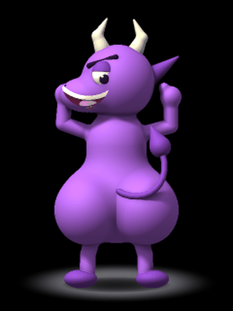
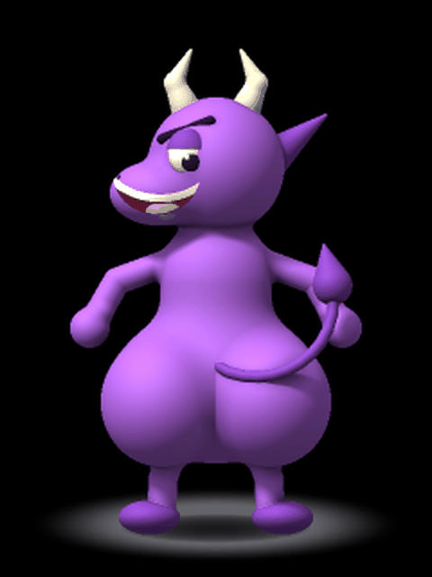
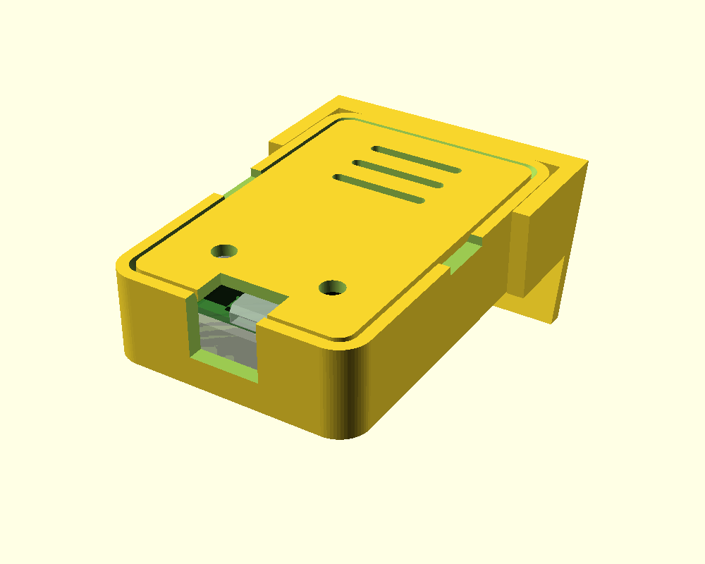

# Triskin

A USB mouse jiggler with a touchscreen, a 3D-printable case and a mascot who shakes his
butt every time it moves your cursor.

<p align="center">
  
  
</p>
<p align="center"><em>Left: waiting. Right: jiggling.</em></p>

Plug it into a computer and it shows up as an ordinary USB mouse. Every so often it nudges
the cursor, which keeps the computer from going idle. No driver and no software on the
computer. Everything is configured on the device's own touchscreen and remembered across
power cycles.

It runs on the [Waveshare RP2350-Touch-LCD-2](https://www.waveshare.com/wiki/RP2350-Touch-LCD-2),
a small board with an RP2350, a 2" 240x320 touch LCD and USB-C.

## What it does

- **Stays out of your way.** By default each jiggle moves the cursor about 2 pixels and
  puts it back, so it will not pull the pointer out from under you mid-click.
- **Puts the cursor back where it found it.** Every movement is undone by replaying it in
  reverse, which lands within a pixel of the starting point even with pointer acceleration
  switched on (see [How the return works](#how-the-return-works)).
- **Configurable on the device.** How often, for how long, how far, how fast, in which
  directions and along what kind of path.
- **Shows you what it is doing.** The mascot dances while waiting, shakes while jiggling,
  and freezes when paused or when no computer is listening.

## Using it

| Do this | To |
|---|---|
| Tap the home screen | Open the settings |
| Swipe left / right | Move between the six settings pages |
| Leave it alone for 5 seconds | Return to the home screen and save |
| Long-press the home screen | Pause or resume jiggling |

### Settings

| Page | Setting | Range | Default |
|---|---|---|---|
| Interval | Time between jiggles: fixed, or random between two limits | 1 s - 1 h | every 60 s |
| Jiggle length | How long each jiggle lasts: fixed, or random between two limits | 0.2 s - 30 s | 2 s |
| Directions | Which of the 8 compass directions the cursor may move in | any combination | all |
| Movement | Distance of one stroke, in mouse counts | 1 - 500 | 3 |
| | Speed | slow / medium / fast | medium |
| Path | **Out & back**: one stroke out, the same stroke back, repeat | | default |
| | **Wander**: random strokes inside a bounding box, then back to the start | box 20 - 2000 | |
| Device | Jiggling on / off, screen brightness, dim the screen when idle, reset | | |

Distances are in mouse counts, not pixels. How many pixels a count is worth depends on the
computer's pointer speed; on the Windows machine this was developed on it is roughly 0.7.

## Building and flashing

You need [PlatformIO](https://platformio.org/). The toolchain and libraries are pinned in
`platformio.ini` and downloaded on the first build.

```
pio run
```

The first time, the board has to be put into its bootloader by hand: hold the **BOOT**
button while plugging in the USB cable, then

```
pio run -t upload
```

After that, `pio run -t upload` reflashes it over USB with no button. An upload takes about
two minutes, most of it the 5 MB of animation frames.

## Case

A snap-together case and a desk stand, both printable without supports, are in
[`case/`](case/). The stand holds the screen at 75 degrees with the USB-C connector at the
top, which is the orientation the firmware draws for.

<p align="center"></p>

## How it works

```
src/
  main.cpp          start-up; core 0 runs the UI, core 1 runs the jiggler
  board/pins.h      pin map of the board
  drivers/          ST7789 display (SPI + DMA) and CST816D touch
  usb/              the USB HID mouse
  jiggle/           when to move and where to: engine.cpp is pure logic, no hardware
  settings/         the settings, their ranges and defaults, and saving them to flash
  ui/               home screen, settings pages, the compass, the mascot player
  assets/           the mascot's animation frames (generated, see below)
  debug/            serial console and stack monitor
tools/
  character/        the mascot: a posable 3D model and the scripts that render it
  screenshot.py     saves what the device is showing as a PNG
case/               OpenSCAD sources, STLs and notes for the printed case
```

Built with the Arduino framework ([arduino-pico](https://github.com/earlephilhower/arduino-pico))
and [LVGL](https://lvgl.io/) 9.

### How the return works

A USB mouse can only say "move this much"; it never learns where the cursor is. So the
firmware keeps track of how far it has moved the cursor from where it started.

That is not enough on its own, because computers apply pointer acceleration: how far a
report moves the cursor depends on how fast the reports arrive. An early version returned
along a straight line, and in one test the cursor ended up 216 pixels from where it began
while the firmware believed it was home. The engine now records every report it sends on
the way out and returns by replaying them backwards, negated, with the same timing. Both
directions then see identical speeds, and the cursor comes back to within a pixel.

One limit remains: if the cursor is pushed against the edge of the screen during a jiggle,
the computer discards part of the movement and the return overshoots.

### The mascot

He is a 3D model defined in Python as a set of rounded volumes, posed by a small rig (hip
swing, bounce, arm angles, head tilt, tail) and rendered frame by frame on a PC. The
firmware only plays the frames back.

To change him or his animation (needs Python with `numpy` and `pillow`):

```
python tools/character/animate.py    # render both loops (a few minutes)
python tools/character/export.py     # pack the frames into src/assets/
pio run -t upload
```

- `tools/character/rig.py` — the pose parameters, and an earlier flat 2D drawing of him
- `tools/character/rig3d.py` — the 3D model, lighting, backdrop and renderer
- `tools/character/animate.py` — the two loops, as functions from time to pose

### Serial console

The device also appears as a USB serial port (115200 baud) with a few commands that are
handy when developing:

| Command | Effect |
|---|---|
| `get` / `set <name> <value>` / `save` / `defaults` | Read, change, store or reset settings |
| `status` | What the jiggler is doing, plus free stack and heap |
| `go` | Start a jiggle now |
| `tap x y`, `hold x y ms`, `swipe x0 y0 x1 y1 ms` | Simulate touches |
| `shot` | Dump the screen; use `tools/screenshot.py` to save it as a PNG |
| `reboot` | Restart |

## Status

Developed and tested against Windows 11. Scheduling, both path modes, the direction mask,
the bounding box, the return to the starting pixel and saving settings were all checked on
the hardware by tracing the real cursor.

Not yet done:

- A long unattended run confirming that a 2-pixel jiggle keeps a computer awake past its
  sleep timeout.
- Testing against macOS and Linux hosts.
- A "pattern" path mode that replays one generated path every time.
- Any use of the board's accelerometer, SD slot or camera connector.

## A note on use

Some employers and services prohibit devices that simulate activity. Whether using one is
acceptable where you are is for you to find out.

## Credits

- [LVGL](https://lvgl.io/) for the UI
- [arduino-pico](https://github.com/earlephilhower/arduino-pico) by Earle F. Philhower, III
- [platform-raspberrypi](https://github.com/maxgerhardt/platform-raspberrypi) by Maximilian Gerhardt

## License

[MIT](LICENSE). It covers everything in this repository: the firmware, the tools, the
mascot and the case design. The libraries it builds against have their own licenses.
